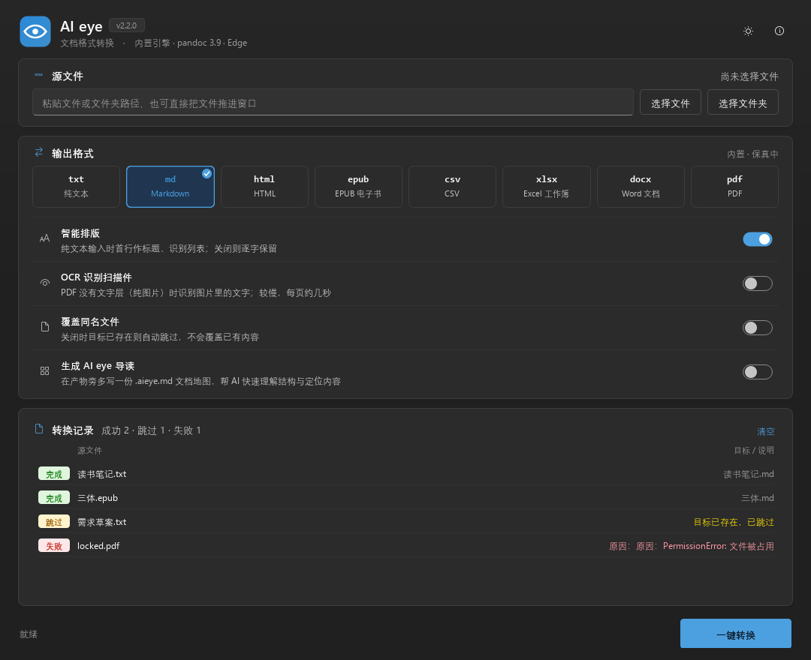

# AI eye · 文档格式互转

> 一眼看懂，一键转好。把文档从一种格式换成另一种 —— 双向、批量、不丢内容。

<p>
  
  
  
  
</p>


txt / md / html / epub / csv / xlsx / docx / pdf 共 8 种格式，任意两种之间可互转。中文编码（GBK / GB18030 / Big5 / UTF-8 / UTF-16）自动识别，Windows 下的记事本老文件不会变乱码；扫描件和图片也能用 OCR 认出来，书里的 K 线图、示意图会被裁出来保留，不再变成一堆坐标数字。

- **开箱即用**：不需要装 pandoc、Office 或 LaTeX，PDF 直接用系统自带的 Edge 打印
- **保真优先**：往返转换后内容零丢失，结构（标题层级、列表嵌套、表格、代码块）完整保留
- **防呆**：会破坏数据的操作一律拒绝，失败绝不留半个文件
- **看得清楚**：扫描件靠「眼睛」认字，图表自动还原成插图；识别结果在软件内直接查看、复制、另存

```
Windows 用户：下载 Releases 里的 AIeye.exe，双击即用
命令行用户：  pip install aieye && aieye report.docx --to md
```

## 支持的格式

| 格式 | 读 | 写 | 实现 | 保真 |
|---|:--:|:--:|---|---|
| `txt` 纯文本 | ✓ | ✓ | 内置 | 逐字 |
| `md` Markdown | ✓ | ✓ | 内置 | 结构完整 |
| `html` | ✓ | ✓ | 内置 | 内容完整 |
| `epub` 电子书 | ✓ | ✓ | 内置（zip + XHTML） | 结构完整 |
| `csv` | ✓ | ✓ | 内置 | 逐格 |
| `xlsx` Excel | ✓ | ✓ | openpyxl | 逐格 |
| `docx` Word | ✓ | ✓ | python-docx | 结构完整 |
| `pdf` | ✓ | ✓ | pdfplumber 读 / 浏览器打印写 | 文本层重排 |
| `image` 图片 | ✓ | — | RapidOCR（png/jpg/webp/bmp/tif） | 仅文字 |

`python aieye.py --formats` 会按你机器上的实际环境打印完整矩阵。缺组件的格式在界面上自动置灰并说明原因，不会让你点了才失败。

### 扫描件与图片 OCR（可选）

PDF 没有文字层（整页都是图片的扫描件）时，勾选界面里的「OCR 识别扫描件」开关，或命令行加 `--ocr`，即可用内置的 RapidOCR 识别文字。图片（png / jpg / webp / bmp / tif）直接当输入即可，OCR 会自动开启——图片没有文字层，这是唯一途径。

- 离线运行，模型随程序分发，不需要安装 Tesseract 之类的第三方软件
- 每页约 1～3 秒，一本 200 页的书需要几分钟，请耐心等待
- 识别结果自带位置信息，标题、列表缩进、引用可以还原；但 OCR 文字可能有误，关键字段请抽查

**图表还原**：扫描书页里的走势图、示意图原本会被 OCR 拆成「3.60 / 2.80 / 放量」这样的碎片混进正文。现在会先做版面切分：

- 图区里的刻度、标注、图序号不进正文
- 图按原位置裁成 PNG 放在 `<输出名>_assets/`，Markdown 里用 `` 引用
- 图注（「图 2-13 上升旗形图例」）挂到图上，不再在正文里重复
- 孤立页码自动剔除
- 不要图时加 `--no-images`；想保留原样（不切分）加 `--no-layout`

**结果查看**：转换完成后双击记录，可直接查看识别出的文字（Markdown / 纯文本两种视图），支持复制全部、复制选中、另存为任意支持格式。

源码安装时 OCR 是可选组件（打包版已内置）：

```bash
pip install "aieye[ocr]"
# 或手动：
pip install opencv-python-headless rapidocr-onnxruntime
```

### EPUB 电子书

`.epub` 既能当输入也能当输出，只用标准库实现（zipfile + xml），没有任何额外依赖。

- **读**：按 spine（出版方定义的阅读顺序）逐章取正文，不用文件名排序——否则一本书的章节会被读乱
- 标题层级、列表、表格、插图都能还原；正文没有标题元素时用目录里的标题补上
- 插图从包里取出来，导出 md/docx 时照常落盘或嵌入
- **写**：按一级标题分章，生成 EPUB 3（含 nav 目录、OPF 清单、封面之外的完整结构），阅读器里能按章翻页
- 元信息（书名、作者、语言）会带过去；EPUB → EPUB 属于同格式，直接复制不重组

### AI eye 导读

`--aieye`（界面里是「生成 AI eye 导读」开关）会在产物旁多写一份 `<名称>.aieye.md`：

- **它是什么**：一份给 AI 看的**文档地图**，不是正文。大模型读整本书有两个现实问题——上下文放不下，放得下也容易「中间迷失」，对中段细节印象最浅。导读先告诉它「这文档有什么、大概在哪」。
- **里面有什么**：YAML front-matter（来源、格式、字数、段落数、图表数）+ 结构地图（每个标题的层级、位置百分比、该章首段摘要）+ 插图清单 + 高频片段 + 使用建议。
- **只做统计，不做语义推断**：没有分词器、没有 embedding、不调用任何模型。凡是需要「理解」才能得出的结论一律不写——给出错的术语表比不给更糟，而且离线机器上必须能生成。
- **怎么用**：把 `.aieye.md` 和正文一起交给 AI，或者只给它导读、让它指出该读哪几段。

### 白天 / 黑夜

右上角的太阳/月亮按钮切换主题，选择会记住。深浅两套是**独立调色板**而不是简单反色：深色主题的强调色亮一档，否则白字压在 `#0F6CBD` 上对比度不够；状态徽标（完成/跳过/失败）也各自配了对，保证深色下仍能一眼分清。

| 白天 | 黑夜 |
|---|---|
|  |  |

## 保真到什么程度

这是选型时最该看的一栏。**格式能力有边界，诚实之处在于提前讲清边界**：

| 转换 | 保留 | 不保留 |
|---|---|---|
| txt ⇄ md | 内容逐字节（`--plain`）／首行标题与列表识别（默认） | — |
| md ⇄ txt | 全部文字、段落、列表、表格（制表符分隔） | Markdown 标记本身 |
| md ⇄ xlsx | 标题级别、列表层级、代码语言、表格 | 段落间空行数量、表格列对齐 |
| md ⇄ docx | 标题、粗体/斜体、嵌套列表、引用、代码块、表格 | 行内代码标记、代码块语言、表格列对齐 |
| csv ⇄ xlsx | 每个单元格、前导零、小数位精度（`12.50` 不会变成 `12.5`） | — |
| * → pdf | 全部内容与基础排版（A4、分页避断行） | 原文档版式 |

xlsx 中转时，正文会落在一张 `_aieye_body` 表里（仅在文档含非表格内容时生成），带类型列，读回时能还原成原来的标题 / 列表 / 代码结构。旧版本（2.0）生成的 `_txt2md_body` 表也能被正确识别。

## 用法

### 图形界面

双击 `AIeye.exe`，或 `python aieye.py --gui`。

选文件 / 文件夹 → 选输出格式 → 转换。格式按钮直接反映本机能力，不可用的置灰并说明原因；转换前就会列出哪些文件会被跳过、为什么。

界面细节：

- **拖放**：文件、文件夹直接拖进窗口，松手即加入
- **双击记录**：查看识别结果并复制文字；右键可「在文件夹中显示」
- **全部跳过时**：记录区右上角出现「覆盖并重转」，一点即可覆盖旧文件
- **记住设置**：输出格式与三个开关在下次启动时保持上次的选择
- **快捷键**：`Ctrl+O` 选文件 · `Ctrl+Shift+O` 选文件夹 · `Ctrl+Enter` 转换 · `F5` 重新扫描

### 命令行

```bash
# 单文件
aieye note.txt                  # txt → md（默认）
aieye report.docx --to txt      # Word → 纯文本
aieye 数据.xlsx --to md          # Excel → Markdown 表格
aieye 手册.md --to pdf           # Markdown → PDF
aieye 扫描件.pdf --to md --ocr   # 纯图片 PDF 走 OCR，图表会自动裁出来
aieye 截图.png --to md           # 图片直接识别（OCR 自动开启）

# 批量（目录递归收集所有支持的格式）
aieye ./docs --to pdf -o ./out  # 保留相对目录结构
aieye ./docs --to xlsx --force  # 覆盖已存在的目标

# 只预检不执行：先看会发生什么
aieye ./docs --to pdf --dry-run

# 查看能力矩阵与本机引擎
aieye --formats
aieye --engines
```

旧命令名 `txt2md` 仍然可用（pip 安装时两个入口都会创建），已有脚本不用改。

### 参数

| 参数 | 说明 |
|---|---|
| `-t, --to 格式` | 目标格式，默认 `md`。也接受别名：`word` / `excel` / `markdown` |
| `-f, --from 格式` | 强制指定源格式（默认按扩展名判断） |
| `-o, --out 目录` | 输出目录，批量时保留相对结构；缺省输出到源文件旁边 |
| `--force` / `--overwrite` | 覆盖已存在的目标（默认跳过） |
| `--plain` | 逐字保真：不加任何 Markdown 标记，内容原样保留 |
| `--encoding 编码` | 强制指定源编码（默认自动探测） |
| `--sheets 名称` | 只转换 xlsx 中指定的工作表，逗号分隔 |
| `--ocr` | PDF 无文字层时用 OCR 识别扫描件（图片输入会自动开启） |
| `--no-layout` | 关闭版面分析：不剔除图内文字，也不裁图 |
| `--no-images` | 不导出插图，只留文字 |
| `--assets-dir 目录` | 插图存放位置，默认 `<输出名>_assets` |
| `--dry-run` | 只预检并列出计划，不实际转换 |
| `--no-verify` | 跳过产物校验（不建议） |
| `--formats` / `--engines` | 显示格式矩阵 / 本机引擎后退出 |
| `-V, --version` | 版本号 |

退出码：`0` 全部成功，`1` 有失败，`2` 参数或路径错误。适合放进脚本与 CI。

## 防呆设计

转换工具最危险的不是转不出来，是**悄悄把东西弄坏**。以下情况一律拒绝执行：

| 情况 | 行为 |
|---|---|
| 源与目标是同一文件 | 拒绝，不询问、不备份、不尝试 |
| 目标已存在 | 默认跳过，需 `--force` 才覆盖；界面上给「覆盖并重转」入口 |
| 批量中两个源产出同名目标 | 自动加 ` (2)` 后缀，不互相覆盖 |
| 文件是二进制伪装成 .txt | 拒绝，不产出乱码 |
| 源文件为空（0 字节） | 拒绝 |
| 目标格式在本机不可用 | 转换前拦下，说明缺什么 |
| 转换中途失败 | 原子写入，不留半个文件 |
| 产物为空但源有内容 | 判定失败，不写空文件糊弄过去 |
| 批量中单个文件失败 | 不中断其余任务，最后汇总 |
| 转换线程内出现意外异常 | 单条记失败，界面不锁死，仍给出汇总 |
| 源格式与目标格式相同 | 逐字节复制，绝不重新排版 |

`--dry-run` 可以在动手前看到完整的「会成功 / 会被跳过 / 为什么」清单。

## 安装

### 直接用（Windows）

下载 Releases 里的 `AIeye.exe`（单文件，免安装），双击运行图形界面。
命令行同样可用：`AIeye.exe report.docx --to md`。

### pip 安装

```bash
pip install aieye            # 核心转换
pip install aieye[gui]       # 带图形界面
pip install "aieye[ocr]"     # 再带上扫描件识别
```

### 从源码

```bash
git clone https://github.com/Xiaolinkemengwei/txt2md.git
cd txt2md
pip install -r requirements.txt
python aieye.py --gui
```

> 仓库目录名仍是 `txt2md`（GitHub 仓库尚未改名），项目名已统一为 **AI eye**。

### 可选组件

以下几个**不是必需**，装了只提升特定能力：

| 组件 | 何时需要 |
|---|---|
| Microsoft Edge / Google Chrome | 生成 PDF。Windows 自带 Edge，通常无需额外安装 |
| `pip install "aieye[ocr]"` | 扫描件识别（打包版已内置） |
| `pip install pypandoc-binary` | 内置实现处理某些特殊文档失败时的兜底（含 231 MB pandoc 二进制） |

## 目录结构

```
txt2md/                   # 仓库目录名（项目名：AI eye）
├─ aieye.py               # CLI 入口与 1.0 兼容 API
├─ core/                  # 转换内核
│  ├─ model.py            #   统一文档模型（块序列 / 工作表）
│  ├─ mdparse.py          #   Markdown 解析与行内降级
│  ├─ htmlio.py           #   HTML 解析与渲染（也用于 PDF 打印排版）
│  ├─ readers.py          #   各格式 → 模型
│  ├─ writers.py          #   模型 → 各格式
│  ├─ ocr.py              #   扫描件识别（RapidOCR）
│  ├─ registry.py         #   格式表、引擎探测、能力矩阵
│  ├─ pipeline.py         #   任务规划、防呆预检、执行与产物校验
│  ├─ legacy.py           #   1.0 排版算法（保证旧输出不变）
│  ├─ pandoc_fallback.py  #   pandoc 兜底通道
│  └─ errors.py           #   分层异常
├─ gui/                   # Fluent Design 桌面界面（theme / widgets / app）
├─ tests/                 # 内核测试 + 界面测试 + 截图
├─ docs/                  # 项目介绍、2.0 设计大纲
├─ research/              # 开源方案调研报告
└─ tools/                 # 构建、图标生成、CI 启用
```

## 开发

```bash
python tests/test_convert.py    # 内核测试（99 项：编码 / 往返 / 防呆 / 全矩阵 / OCR）
python tests/test_gui_flow.py   # 界面测试（28 项：扫描 / 格式 / 转换 / 布局 / 异常恢复）
python tests/shot_gui.py        # 离屏渲染界面截图，检查视觉
python tools/build.py           # 打包
```

内核测试里的「42 个格式组合无崩溃」会真的把每种组合跑一遍，不含糊。

## 已知限制

- **PDF 只取文本层**：扫描版 PDF（无文本层）需勾选 OCR 识别，识别文字可能有误
- **PDF 输出是文本重排**：不是原文档的版式复刻
- **docx 不保留**：分栏、页眉页脚、脚注、批注、内嵌图片（文字内容不受影响）
- **xlsx 中转会丢列对齐**：Excel 里没有与 Markdown 表格对齐对应的概念
- **不支持**：`.doc`（旧版）、`.ppt`、`.epub`

## 从 1.0 / 2.0 升级

命令行用法完全兼容：`aieye note.txt` 依旧输出 `note.md`，`--plain` 依旧表示逐字保留。1.0 的排版算法原样保留在 `core/legacy.py` 并作为 txt → md 的直通通道，输出与 1.0 字节级一致。

2.0 的命令名 `txt2md` 仍作为别名存在；`_txt2md_body` 工作表也能被 2.1 正确读回。

## 许可证

[MIT](LICENSE)。第三方组件许可见 [THIRD_PARTY_NOTICES.md](THIRD_PARTY_NOTICES.md)。

## 更多文档

- [项目介绍（完整版）](docs/项目介绍.md)
- [2.3 发布说明](docs/RELEASE_NOTES_v2.3.0.md) · [EPUB、AI 导读与深色主题方案](docs/2.3-方案-EPUB与AI导读.md)
- [2.2 发布说明](docs/RELEASE_NOTES_v2.2.0.md) · [图表还原与图片识别方案](docs/2.2-方案-图表还原与图片识别.md)
- [2.1 发布说明](docs/RELEASE_NOTES_v2.1.0.md)
- [2.0 设计与实现大纲](docs/2.0-设计与实现大纲.md)
- [2.0 开源方案调研](research/2026-11-07-2.0-多格式互转调研.md)
- [贡献指南](CONTRIBUTING.md) · [变更日志](CHANGELOG.md)
