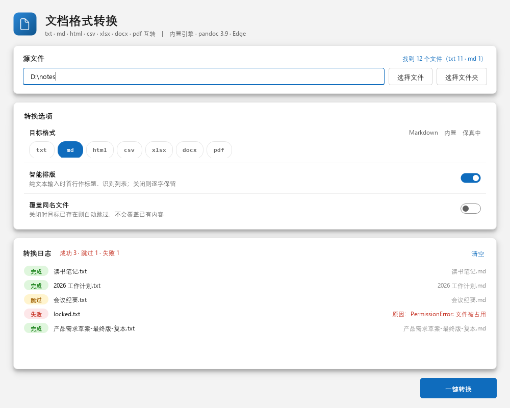

# txt2md

> 把一堆 TXT 笔记一键变成 Markdown —— 批量转换、中文编码自动识别、Fluent Design 桌面界面。

<p>
  
  
  
  
</p>



## 为什么做这个

中文 Windows 上的 `.txt` 笔记多半是 GBK 编码，丢进 Markdown 编辑器就是一堆乱码；
批量改扩展名又会丢掉标题层级。`txt2md` 把这件事收敛成一次点击：

- **自动识别编码**（BOM / UTF-8 / Big5 / GBK），记事本文件不再乱码，输出统一 UTF-8
- **保守的智能排版**：只加标题、识别列表，**不删改任何正文**
- **批量处理**：整目录递归，单个文件失败不影响其他
- **本地运行**：不联网、不上传、不改原文件

## 两种用法

| 入口 | 依赖 | 适合 |
|---|---|---|
| 图形界面（Fluent Design） | PySide6 | 不想碰命令行，需要逐条查看结果 |
| 命令行 | **纯标准库，零依赖** | 脚本 / 批量 / 服务器 / CI |

## 安装

### 下载即用（推荐）

1. 到 [Releases](https://github.com/Xiaolinkemengwei/txt2md/releases) 下载 `txt2md-1.0.0-win64.zip`
2. 解压到任意目录（免安装、不写注册表）
3. 双击 `txt2md.exe`

> 未签名程序首次运行可能触发 SmartScreen，选择「更多信息 → 仍要运行」。
> 程序不联网，可用抓包或防火墙自行验证。

### pip

```bash
pip install txt2md          # 仅命令行
pip install "txt2md[gui]"   # 含图形界面
```

### 源码

```bash
git clone https://github.com/Xiaolinkemengwei/txt2md.git
cd txt2md

python txt2md.py notes.txt            # 命令行：无需安装依赖
python -m pip install -r requirements.txt
python txt2md.py --gui                # 图形界面
```

Windows 也可以双击 `启动GUI.bat`，会自动补齐缺失依赖再启动。

## 使用

### 图形界面

选择文件或文件夹（支持多选、拖拽、粘贴路径）→ 设置选项 → 「一键转换」（或 `Ctrl+Enter`）
→ 日志逐条显示 `完成 / 跳过 / 失败`，右侧为输出文件名或失败原因。

| 选项 | 默认 | 说明 |
|---|---|---|
| 智能排版 | 开 | 首行作 `# 标题`、识别已有列表与 Markdown 语法 |
| 覆盖已存在的 .md | 关 | 关闭时同名文件自动跳过，不会覆盖已有内容 |

### 命令行

```bash
python txt2md.py note.txt                  # 单文件，输出到源文件旁
python txt2md.py a.txt b.txt c.txt         # 多文件
python txt2md.py ./notes -o ./out          # 整目录递归，保留子目录结构
python txt2md.py ./notes --plain           # 纯转换，内容一字不动
python txt2md.py ./notes --overwrite       # 覆盖同名 .md
python txt2md.py --version                 # 版本号
```

| 参数 | 说明 |
|---|---|
| `paths` | `.txt` 文件或目录（可多个，目录递归） |
| `-o, --out DIR` | 输出目录；缺省输出到源文件旁 |
| `--smart` | 智能排版（默认开启） |
| `--plain` | 内容原样保留，仅改扩展名 |
| `--overwrite` | 覆盖已存在的 `.md` |
| `--gui` | 启动图形界面 |
| `-V, --version` | 显示版本号 |

输出示例：

```
✓ notes\读书笔记.txt
    -> notes\读书笔记.md
- notes\会议纪要.txt
    -> notes\会议纪要.md
✗ notes\locked.txt
    原因: [Errno 13] Permission denied

汇总: 成功 1 / 跳过 1 / 失败 1
```

退出码：全部成功或有跳过为 `0`，存在失败为 `1`。

## 智能排版的规则（以及为什么这么保守）

按顺序匹配，命中即停：

1. 空行 → 保留（分隔段落）
2. 已是 Markdown（`#`、`>`、`-`/`*`/`1.`、`---`）→ **原样保留**
3. 全大写英文短行（≤60 字符、无句点）→ `## Title`
4. 文件首个非空文本行 → `# 该行`
5. 其他 → 原样输出

**不做**：按行宽折行、自动加粗、猜测代码块、按「空格少」判定代码。
中文没有词间空格，任何依赖空格数量的规则都会误伤正文——这也是本项目没有照搬某个
热门实现的原因，详见 [research/2026-11-07-txt2md-开源调研.md](research/2026-11-07-txt2md-开源调研.md)。

## 目录结构

```
txt2md/
├─ txt2md.py              # 转换核心 + 命令行（零第三方依赖）
├─ gui/                   # Fluent 界面层（theme / widgets / app）
├─ assets/icon.ico        # 多尺寸图标
├─ tools/                 # build.py 一键构建、make_icon.py 图标、enable_ci.py
├─ tests/                 # 样例、界面层测试、多尺寸截图
├─ ci/                    # GitHub Actions 工作流（启用方式见 ci/README.md）
├─ docs/项目介绍.md        # 完整项目文档
├─ txt2md.spec            # PyInstaller 配置
└─ pyproject.toml         # 包元数据
```

## 自行打包

```bash
python -m pip install -r requirements.txt pyinstaller
python tools/build.py --clean
```

产物在 `dist/`：`txt2md.exe`（单文件 GUI，35.8 MB）、`txt2md-1.0.0-win64.zip`、
`txt2md-1.0.0-py3-none-any.whl`、`txt2md-1.0.0.tar.gz`，并自动生成 `SHA256SUMS.txt`。
`--onedir` 可产出启动更快的目录版；版本号唯一来源是 `txt2md.py` 的 `__version__`。

## 文档

- [项目介绍（完整版）](docs/项目介绍.md)：功能特性、配置说明、架构设计、打包发布、路线图
- [2.0 设计与实现大纲](docs/2.0-设计与实现大纲.md)：格式矩阵、双向转换架构、选型建议、阶段划分
- [贡献指南](CONTRIBUTING.md)：环境、代码约定、PR 检查清单
- [变更日志](CHANGELOG.md)
- [第三方组件与许可](THIRD_PARTY_NOTICES.md)
- [开源方案调研](research/2026-11-07-txt2md-开源调研.md)
- [2.0 多格式互转调研](research/2026-11-07-2.0-多格式互转调研.md)：候选对照与实测记录

## 测试

```bash
python txt2md.py tests/sample -o tests/out --overwrite   # 命令行回归
python tests/test_gui_flow.py                            # 界面层功能测试
python tests/shot_gui.py                                 # 多尺寸视觉回归
```

CI 工作流定义在 `ci/` 目录。首次启用需给 GitHub token 勾选 `workflow` 权限，然后：

```bash
python tools/enable_ci.py && git push origin main
```

启用后：`ci.yml` 在每次 push/PR 上跑三个 Python 版本的校验与截图；`release.yml`
在推送 `v*` 标签时自动构建并创建 Release。

## 已知限制

- 界面固定亮色主题，未跟随系统深色模式
- 打包产物仅 Windows；macOS/Linux 可从源码运行
- 只处理 `.txt`；不识别表格、图片、脚注
- 整体读入内存，超大文件未优化

## 许可证

[MIT](LICENSE) © 2026 txt2md contributors

打包版内含 Qt/PySide6（LGPL-3.0），相关义务见 [THIRD_PARTY_NOTICES.md](THIRD_PARTY_NOTICES.md)。
若无法接受 LGPL，可只使用纯标准库的命令行部分。

## 贡献

欢迎 Issue 与 PR。提交前请跑通上面三条测试命令，并遵循 [CONTRIBUTING.md](CONTRIBUTING.md) 中的分层与样式约定。
